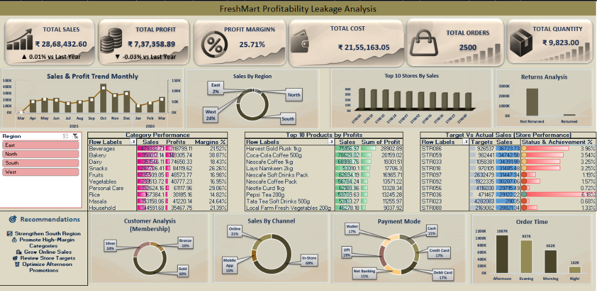
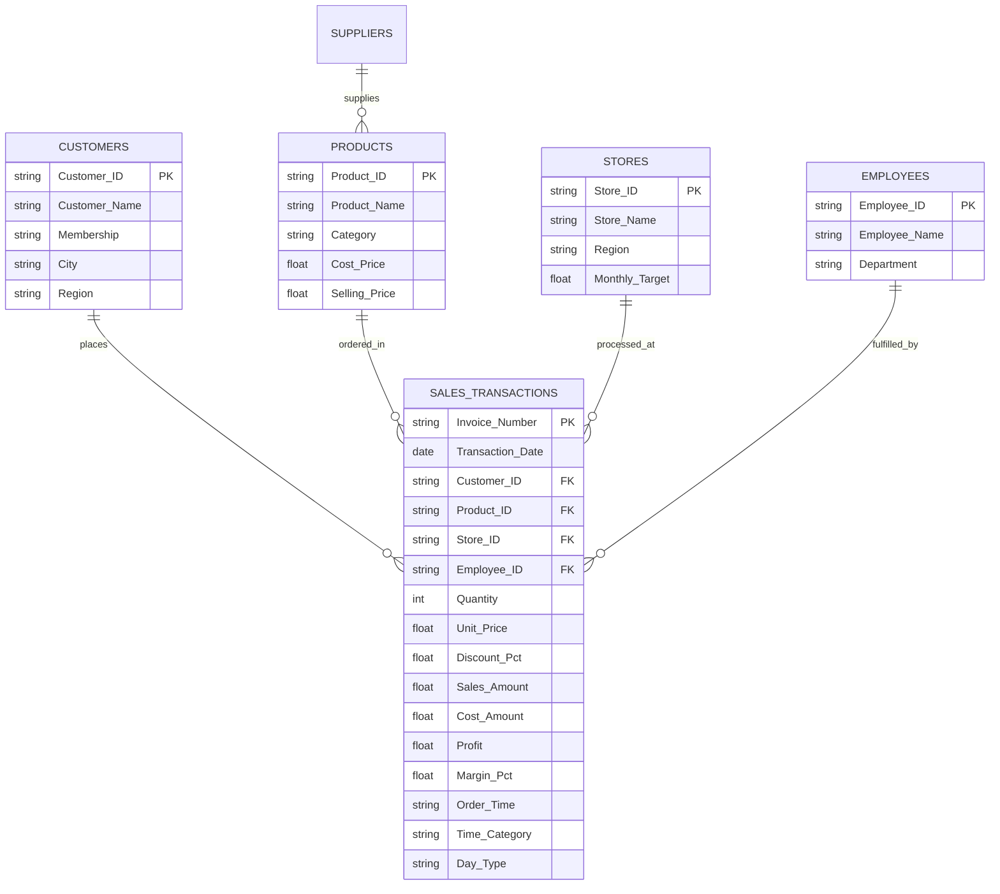
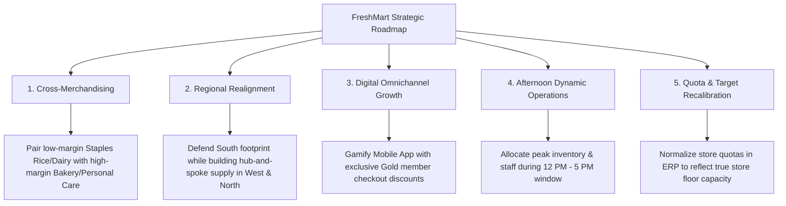

# 🛒 FreshMart — Profitability Leakage & Retail Performance Analysis

[](https://www.microsoft.com/en-us/microsoft-365/excel)
[](https://github.com/)
[](https://github.com/)
[](https://github.com/)

---

## 📌 Executive Summary

**FreshMart** is a fast-moving consumer goods (FMCG) and grocery supermarket chain operating across multiple regional zones. This project delivers an enterprise-level **Profitability Leakage Analysis & Interactive Executive Dashboard** built using advanced Microsoft Excel techniques.

Although FreshMart generated **₹ 28,68,432.60** in total gross revenue across **2,500 transactions** and **9,823 units sold**, net profitability experienced a marginal contraction (**-0.03% YoY decline** to **₹ 7,37,358.89** with an aggregate profit margin of **25.71%**). 

This project audits multi-source relational datasets (Customers, Products, Stores, Employees, Suppliers, and Sales Transactions), performs rigorous data cleansing and feature engineering, investigates operational bottlenecks, identifies margin leakage across product categories and regional sales channels, and delivers data-backed recommendations for margin expansion.

---

## 🖥️ Executive Dashboard Preview

The dynamic executive dashboard features interactive slicers, synchronized Pivot Charts, conditional formatting KPI indicators, and diagnostic visual cards:



---

## 🎯 Key Performance Indicators (KPIs)

| Metric | Recorded Value | YoY Performance | Business Implication |
| :--- | :---: | :---: | :--- |
| **Total Gross Sales** | **₹ 28,68,432.60** | ▲ **+0.01%** | Steady transaction volume across 2,500 orders |
| **Total Net Profit** | **₹ 7,37,358.89** | ▼ **-0.03%** | Margin compression due to category discounting & returns |
| **Blended Profit Margin** | **25.71%** | Stable (~25.7%) | Strong baseline margin driven by Bakery & Beverages |
| **Total Cost of Goods (COGS)** | **₹ 21,55,163.05** | — | Cost base represents 74.29% of gross revenue |
| **Total Order Transactions** | **2,500 Orders** | ▲ **+0.01%** | Healthy order frequency across retail stores |
| **Total Quantity Sold** | **9,823 Units** | — | High product throughput across 10 FMCG categories |
| **Average Order Value (AOV)** | **₹ 1,147.37** | ▲ **+0.01%** | Basket size indicates consistent basket composition |

---

## 📂 Repository & Folder Architecture

```text
Freshmart/
│
├── Final DashBoard Sheet/
│   └── Mohammed Afraan fresh mart.xlsx          # Master multi-tab analytical model with dynamic Dashboard
│
├── FreshMart (Cleaned DataSet)/
│   └── FreshMart_ALL_CLEANED.xlsx               # Consolidated, cleaned & relational data schema
│
├── FreshMart (Raw DataSet)/
│   ├── FreshMart_Customers (1).xlsx             # Raw customer demographics & membership records (700 rows)
│   ├── FreshMart_Employess (1).xlsx             # Raw employee directory & store assignments (350 rows)
│   ├── FreshMart_Products (1).xlsx              # Raw product catalog, unit costs & prices (150 rows)
│   ├── FreshMart_Sales_Transactions (1).xlsx    # Raw POS transaction logs (2,500 rows)
│   ├── FreshMart_Stores (1).xlsx                # Raw store master data & sales targets (180 rows)
│   └── FreshMart_Suppliers (1).xlsx             # Raw supplier records, lead times & ratings (85 rows)
│
├── freshmart_dashboard.png                      # High-resolution screenshot of the executive dashboard
└── README.md                                    # Project documentation and analytical report
```

---

## 🗄️ Relational Schema & Data Modeling

The analytical model transforms disconnected raw retail tables into a consolidated **Star-Schema** within `Sales Sheet`:



---

## 🧹 Data Cleaning & Feature Engineering

1. **Relational Enrichment (`VLOOKUP` & `XLOOKUP`)**:
   - Enriched raw POS transaction data with customer names, loyalty tiers (`Gold`, `Silver`, `Bronze`), product taxonomy, store metadata, targets, and employee rosters.
2. **Time Bucket Segmentation**:
   - Extracted order hours from POS timestamps into four analytical shopping bands using nested logic:
     ```excel
     =IF(HOUR(AB2)>=6, IF(HOUR(AB2)<12, "Morning", IF(HOUR(AB2)<17, "Afternoon", IF(HOUR(AB2)<21, "Evening", "Night"))), "Night")
     ```
3. **Day Type Categorization**:
   - Automated weekday versus weekend transaction tagging:
     ```excel
     =IF(WEEKDAY(B2, 2)<=5, "Weekday", "Weekend")
     ```
4. **Financial Margin & Target Tracking**:
   - Unit Margin %:
     ```excel
     =([@[Sales_Amount]] - [@[Cost_Amount]]) / [@[Sales_Amount]]
     ```
   - Target Achievement Ratio:
     ```excel
     =[@[Sales_Amount]] / [@[Monthly_Target]]
     ```
5. **Data Hygiene & Cleansing**:
   - Standardized payment methods into uniform categories (`UPI`, `Cash`, `Credit Card`, `Debit Card`, `Wallet`, `Net Banking`).
   - Cleaned trailing whitespace and inconsistent region casings.
   - Reconciled return transaction flags (`Returned` vs `Not Returned`).

---

## 📊 Analytical Insights & Findings

### 1. Product Category Margin & Profit Contribution
- **Bakery** emerged as the most profitable segment, producing **₹ 1,49,305.74** in profit on ₹ 3,58,017.14 in sales (**38.87% margin**).
- **Beverages** drove the highest gross volume (**₹ 4,79,332.71**) and generated **₹ 1,18,799.11** in profit (**21.52% margin**).
- **Personal Care** delivered healthy margins (**29.06%**, ₹ 61,117.96 profit).
- **Staples Margin Leakage**: Essential grocery categories like **Rice (14.82%)**, **Vegetables (16.95%)**, and **Fruits (16.98%)** had low profit margins, indicating aggressive markdowns or price-matching pressures that suppress net margins.

| Category | Sales (₹) | Profits (₹) | Margin % | Margin Health |
| :--- | :---: | :---: | :---: | :--- |
| **Bakery** | ₹ 3,58,017.14 | ₹ 1,49,305.74 | **38.87%** | 🟢 High Margin Hero |
| **Personal Care** | ₹ 1,92,624.16 | ₹ 61,117.96 | **29.06%** | 🟢 High Margin Driver |
| **Snacks** | ₹ 2,87,706.41 | ₹ 84,119.62 | **26.26%** | 🟢 Solid Performer |
| **Masala** | ₹ 1,53,158.06 | ₹ 41,220.14 | **24.64%** | 🟡 Moderate Margin |
| **Beverages** | ₹ 4,79,332.71 | ₹ 1,18,799.11 | **21.52%** | 🟡 Volume Driver |
| **Household** | ₹ 1,44,591.68 | ₹ 35,467.75 | **21.39%** | 🟡 Moderate Margin |
| **Dairy** | ₹ 3,51,546.11 | ₹ 74,650.33 | **18.43%** | 🔴 Thin Margin |
| **Fruits** | ₹ 2,35,509.05 | ₹ 46,573.77 | **16.98%** | 🔴 Commodity Margin |
| **Vegetables** | ₹ 2,18,513.72 | ₹ 40,777.23 | **16.95%** | 🔴 Perishable Dilution |
| **Rice** | ₹ 1,67,384.10 | ₹ 30,185.16 | **14.82%** | 🔴 Lowest Margin Staple |

---

### 2. Top 10 Profit-Generating SKUs
1. **Harvest Gold Rusk 1kg**: Sales: ₹ 75,156.97 | Profit: **₹ 28,902.89**
2. **Coca-Cola Coffee 500g**: Sales: ₹ 78,629.02 | Profit: **₹ 20,159.02**
3. **Nescafe Coffee 1kg**: Sales: ₹ 68,998.76 | Profit: **₹ 19,301.51**
4. **Lays Namkeen 2kg**: Sales: ₹ 53,010.10 | Profit: **₹ 17,706.30**
5. **Nescafe Soft Drinks Pack**: Sales: ₹ 62,694.19 | Profit: **₹ 16,965.71**
6. **Nescafe Coffee Pack**: Sales: ₹ 56,784.24 | Profit: **₹ 13,571.22**
7. **Nestle Curd 1kg**: Sales: ₹ 62,189.96 | Profit: **₹ 13,328.34**
8. **Pepsi Tea 200g**: Sales: ₹ 53,709.63 | Profit: **₹ 13,245.28**
9. **Tata Tea Soft Drinks 500g**: Sales: ₹ 53,103.27 | Profit: **₹ 11,255.97**
10. **Local Farm Fresh Vegetables 200g**: Sales: ₹ 46,278.18 | Profit: **₹ 9,037.92**

---

### 3. Geographical Concentration Risk
- **South Region** dominates corporate revenue, generating **₹ 18,72,387.89 (~65.3%)**.
- **West Region** contributes **₹ 6,86,451.93 (24.0%)**.
- **North Region** brings in **₹ 2,46,937.59 (8.6%)**.
- **East Region** lags substantially at only **₹ 62,655.19 (2.2%)**.
> **Diagnosis**: Severe geographical revenue concentration exposes the company to localized market shocks.

---

### 4. Sales Channel & Customer Loyalty Dynamics
- **In-Store Shopping**: Represents **68.7%** (₹ 19,69,380.30) of sales.
- **Online Web Channel**: Accounts for **21.3%** (₹ 6,12,494.35).
- **Mobile App**: Captures only **10.0%** (₹ 2,86,557.95).
- **Membership Contribution**:
  - **Gold Tier**: Drives **59.9%** (₹ 17,17,840.48) of total revenue.
  - **Silver Tier**: Contributes **23.6%** (₹ 6,77,005.88).
  - **Bronze Tier**: Contributes **16.5%** (₹ 4,73,586.24).
> **Diagnosis**: Gold tier customers are the financial backbone of FreshMart. However, digital mobile app adoption remains under-indexed.

---

### 5. Shopping Hour Distribution
- **Afternoon (12 PM - 5 PM)**: Peak revenue window at **₹ 10,87,071.55 (37.9%)**.
- **Evening (5 PM - 9 PM)**: Second highest window at **₹ 9,37,274.78 (32.7%)**.
- **Morning (6 AM - 12 PM)**: Steady flow of **₹ 6,61,764.90 (23.1%)**.
- **Night (9 PM onwards)**: Tapered off at **₹ 1,82,321.37 (6.3%)**.

---

### 6. Store Target vs Actual Performance Discrepancy
An audit of store performance tables revealed an organizational target misalignment:
- Top retail stores (e.g., `STR086`, `STR059`, `STR033`, `STR018`) generated between **₹ 28,000 and ₹ 37,000** in monthly sales.
- However, baseline store targets recorded in ERP ranged from **₹ 9,26,000 up to ₹ 42,82,000**, resulting in nominal achievement rates of **0.68% – 6.18%**.
> **Root Cause**: The monthly store target column in the raw database holds annual or quarterly quotas rather than monthly operational store targets, creating skewed performance KPI metrics.

---

## 💡 Strategic Recommendations



1. **Promote High-Margin Hero Categories**:
   - Bundle high-velocity, thin-margin staple items (Rice, Vegetables, Milk) with high-margin impulse items (Bakery, Gourmet Coffee, Personal Care).
2. **Strengthen South & Incubate West/North**:
   - Maintain market leadership in South India while expanding modern format stores into growing urban clusters in the West and North zones.
3. **Accelerate Mobile App & Digital Loyalty**:
   - Launch app-only flash sales during low-traffic morning and night hours to level sales throughout the day.
4. **Optimize Floor Staffing for Peak Afternoon Hours**:
   - Ensure dynamic shelf restock and express billing lanes operate at maximum capacity between 12:00 PM and 5:00 PM.
5. **Recalibrate Store Performance Targets**:
   - Fix target quotas in the master store database to prevent skewed store achievement reporting.

---

## 🛠️ Excel Skills & Methodologies Demonstrated

- **Relational Data Modeling**: Star-schema join design linking 6 tables.
- **Lookup & Reference Functions**: `XLOOKUP`, `VLOOKUP`, `INDEX/MATCH`.
- **Date & Time Intelligence**: `HOUR()`, `WEEKDAY()`, nested `IF()` logical classification.
- **Aggregation & Statistical Metrics**: `SUM`, `AVERAGE`, `COUNTIF`, `COUNTA`.
- **Dynamic Pivot Tables**: Multi-level row hierarchies, custom calculated fields, and running totals.
- **Executive Visual Design**: Cohesive color palette, custom KPI cards, sparklines, in-cell data bars, and dynamic slicers.

---

## 👨‍💻 Project Information

- **Analyst**: Mohammed Afraan
- **Tooling**: Microsoft Excel (Office 365)
- **Dataset Domain**: Supermarket & FMCG Retail Analytics
