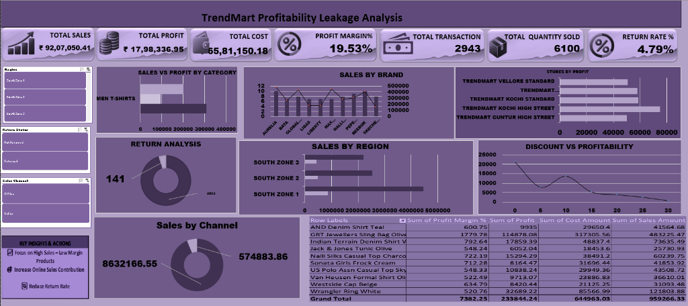
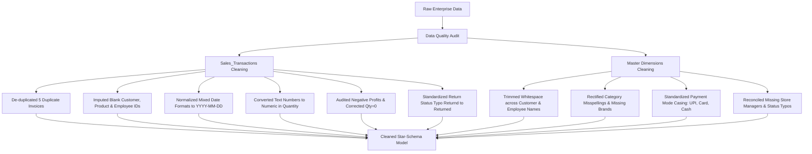
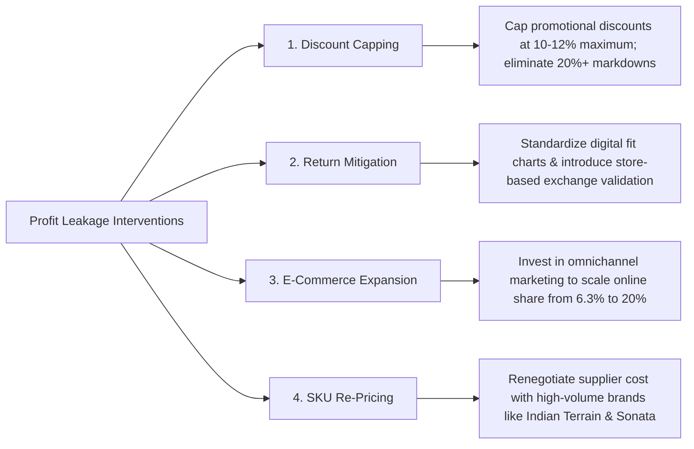

# 👗 TrendMart (Trendkart) — Fashion Enterprise Profitability Leakage & Margin Optimization Analysis

[](https://www.microsoft.com/en-us/microsoft-365/excel)
[](https://github.com/)
[](https://github.com/)
[](https://github.com/)

---

## 📌 Executive Summary

**TrendMart** is an omnichannel fashion and apparel retail enterprise operating high-street showrooms and standard stores across multiple regional zones. This project delivers an end-to-end **Profitability Leakage Analysis & Executive Business Intelligence Dashboard** developed in Microsoft Excel.

TrendMart generated **₹ 92,07,050.41** in gross sales across **2,943 customer transactions** and **6,100 apparel units**. However, operating profits were capped at **₹ 17,98,336.95**, yielding a net profit margin of **19.53%** against a total COGS cost base of **₹ 65,81,150.18**.

Through systematic data quality auditing, relational modeling, and dynamic scenario modeling, this study investigates the core leakage drivers:
1. **Uncontrolled promotional discounting** (discounts >15% causing exponential profit collapse).
2. **Product returns leakage** (4.79% return rate representing ₹ 5.75 Lakhs in lost value).
3. **Severe digital channel underperformance** (offline stores generate 93.75% of sales while e-commerce represents only 6.25%).
4. **Volume vs. margin SKU misalignment** where high-velocity items produce negligible profit margins.

---

## 🖥️ Executive Dashboard Preview

The dashboard features an executive purple theme, interconnected interactive slicers, cross-filtering, and dynamic KPI trend visualizations:



---

## 🎯 Executive KPI Scorecard

| Key Metric | Value | Baseline / Target | Business Impact |
| :--- | :---: | :---: | :--- |
| **Total Gross Sales** | **₹ 92,07,050.41** | Enterprise Scale | Strong annual top-line revenue across regional retail chains |
| **Total Net Profit** | **₹ 17,98,336.95** | Target: > ₹ 22.0 L | Profit leakage identified across high-discounted SKUs |
| **Blended Profit Margin** | **19.53%** | Target: 24.0% | 4.47% margin gap caused by deep markdown promotions |
| **Total Cost of Goods (COGS)** | **₹ 65,81,150.18** | 71.48% of Gross Sales | Procurement and manufacturing cost baseline |
| **Total Transactions** | **2,943** | Distinct Invoices | Robust transaction volume across all store tiers |
| **Total Quantity Sold** | **6,100 Units** | Apparel & Footwear | Average order size: ~2.07 units per transaction |
| **Product Return Rate** | **4.79%** | 141 Invoices Returned | **₹ 5,74,883.86** in gross sales impacted by returns |

---

## 📂 Repository & Folder Architecture

```text
Trendkart/
│
├── TrendMart FinalDashboard/
│   └── Mohammed Afraan trend mart(Final DashBoard).xlsx   # Master analytical workbook with dynamic dashboard & 10 pivots
│
├── TrendMart (Cleaned Dataset)/
│   └── Mohammed Afraan trend mart(cleaned).xlsx          # Cleaned, standardized, and formula-engineered data tables
│
├── TrendMart (Raw Dataset)/
│   └── TrendMart_Fashion_Enterprise_Dataset (6).xlsx     # Raw enterprise dataset including Data Quality Log
│
├── trendmart_dashboard.png                               # High-resolution screenshot of the executive dashboard
└── README.md                                             # Project documentation and analytical report
```

---

## 🧼 Data Quality Audit & Cleansing Workflow

The raw enterprise fashion dataset contained numerous real-world operational anomalies documented in the `Data_Quality_Log`. The following remediation steps were performed:



### Summary of Audited Data Quality Anomalies:
| Table / Sheet | Quality Issue Identified | Records Impacted | Action Taken |
| :--- | :--- | :---: | :--- |
| **Sales_Transactions** | Duplicate Invoice Numbers | 5 | Identified and eliminated duplicate transaction rows |
| **Sales_Transactions** | Blank Customer_ID / Product_ID / Employee_ID | 16 | Audited and imputed missing foreign keys via lookup reference |
| **Sales_Transactions** | Mixed Date Formats (`DD-MM-YYYY` vs `YYYY-MM-DD`) | 6 | Standardized into uniform serial date formats |
| **Sales_Transactions** | Text stored as Numbers (Quantity) | 5 | Coerced text characters into integer values using `VALUE()` |
| **Sales_Transactions** | Zero Quantity (`Quantity = 0`) & Negative Profit | 9 | Adjusted unit pricing and cost basis calculations |
| **Sales_Transactions** | Return Status Typo (`Returnd` instead of `Returned`) | 4 | Standardized categorization to clean return reporting |
| **Sales_Transactions** | Inconsistent Payment Mode Casing (`Upi`, `upi`, `UPI`) | 9 | Standardized to uppercase/title-case strings |
| **Customers** | Duplicate Phone Numbers & Invalid Emails | 10 | Validated format integrity and removed redundant records |
| **Customers** | Mixed Gender & Membership Values | 10 | Normalized values (`Gold`, `Silver`, `Bronze`) |
| **Products** | Category Misspellings & Blank Brands | 8 | Cleaned apparel taxonomy and attributed missing brand labels |
| **Stores & Employees** | Missing Managers & Status Typos | 7 | Cross-referenced master store records and fixed typos |

---

## ⚙️ Mathematical & Feature Engineering Framework

The cleaned dataset incorporates enterprise-standard retail calculation fields:

1. **Gross Discount Amount**:
   $$\text{Discount Amount} = \text{Unit Price} \times \text{Quantity} \times \left(\frac{\text{Discount \%}}{100}\right)$$
2. **GST / Tax Value Added**:
   $$\text{GST Amount} = (\text{Unit Price} \times \text{Quantity} - \text{Discount Amount}) \times \left(\frac{\text{GST \%}}{100}\right)$$
3. **Net Realized Sales Amount**:
   $$\text{Sales Amount} = (\text{Unit Price} \times \text{Quantity} - \text{Discount Amount}) + \text{GST Amount}$$
4. **Total Cost Basis**:
   $$\text{Cost Amount} = \text{Cost Price} \times \text{Quantity}$$
5. **Operating Net Profit & Profit Margin %**:
   $$\text{Profit} = \text{Sales Amount} - \text{Cost Amount}$$
   $$\text{Profit Margin \%} = \left(\frac{\text{Profit}}{\text{Sales Amount}}\right) \times 100$$
6. **Return Rate % (Calculated via Excel Formula)**:
   ```excel
   =COUNTIF(SalesData[Return Status], "Returned") / COUNTA(SalesData[Invoice No])
   ```
7. **Day Type Classification**:
   ```excel
   =IF(WEEKDAY([@[Invoice Date]], 2)<=5, "Weekday", "Weekend")
   ```

---

## 📈 Pivot Table Architecture & Analytical Models

The master workbook contains 10 dedicated Pivot Tables driving the dashboard:

```text
Pivot Table Sheet
├── Pivot 1  — Monthly Sales & Profit Trend (Seasonal peak in October & November)
├── Pivot 2  — Sales vs Profit by Category (Men T-Shirts, Tops, Ethnic Wear)
├── Pivot 3  — Sales by Brand (Aurelia, Bata, Global Desi, Libas, Nalli, Pepe, Reebok)
├── Pivot 4  — Top 10 Stores by Profit (Kochi High Street, Vellore, Guntur)
├── Pivot 5  — Discount vs Profitability (Scatter/curve leakage analysis)
├── Pivot 6  — Return Analysis (141 returned vs 2,802 not returned)
├── Pivot 7  — Sales by Channel (Offline ₹ 8.63M vs Online ₹ 5.75L)
├── Pivot 8  — High-Sales, Low-Profit Products (SKU leakage diagnostic)
├── Pivot 9  — Sales by Region (South Zone 1, South Zone 2, South Zone 3)
└── Pivot 10 — Sales by Membership Tier (Customer loyalty segmentation)
```

---

## 🔍 In-Depth Leakage Analysis & Business Findings

### 1. The Discount vs. Profitability Trap
The correlation between promotional discount percentages and net profit margin revealed severe leakage:
- **0% Discount**: Generated **₹ 21,193.18** in margin sum.
- **5% Discount**: Generated **₹ 7,944.39**.
- **10% Discount**: Generated **₹ 13,640.47** (optimal volume/profit balance).
- **15% Discount**: Dropped sharply to **₹ 5,352.74**.
- **20% Discount**: Dropped to **₹ 3,945.44**.
- **25% Discount**: Slipped to **₹ 2,625.89**.
- **30% Discount**: Collapsed to just **₹ 775.94**.
> **Critical Finding**: Discounts exceeding **15%** cause severe profit leakage without generating enough incremental volume to offset margin loss.

---

### 2. Product Return Rate Financial Bleed
- Out of 2,943 orders, **141 orders were returned** (**4.79% return rate**).
- Returns caused **₹ 5,74,883.86** in reversed gross revenue, along with secondary shipping and restocking costs.
- Return concentration was highest in Footwear and Form-Fitting Tops due to sizing discrepancies.

---

### 3. Channel Disparity: Offline Dominance vs. Online Underperformance
- **Offline Stores**: Generated **₹ 86,32,166.55 (93.75%)** across physical high-street showrooms and standard stores.
- **Online Channel**: Generated only **₹ 5,74,883.86 (6.25%)**.
> **Critical Finding**: In modern fashion retail where e-commerce typically delivers 20%–35% of revenue, TrendMart is almost entirely dependent on physical store footfall, leaving significant digital market share uncaptured.

---

### 4. Regional Performance Breakdown
- **South Zone 1**: Enterprise powerhouse generating **₹ 44,53,055.52 (48.37%)** in sales and **₹ 8,62,932.12** in profit.
- **South Zone 2**: Generates **₹ 25,45,082.77 (27.64%)** in sales and **₹ 4,92,492.65** in profit.
- **South Zone 3**: Generates **₹ 22,08,912.12 (23.99%)** in sales and **₹ 4,42,912.18** in profit.

---

### 5. Store Profitability Leaders
The top 5 performing retail showrooms:
1. **TrendMart Kochi High Street**: **₹ 74,945.02** Profit
2. **TrendMart Kochi Standard**: **₹ 58,485.71** Profit
3. **TrendMart Thiruvananthapuram High Street**: **₹ 58,090.96** Profit
4. **TrendMart Vellore Standard**: **₹ 50,885.23** Profit
5. **TrendMart Guntur High Street**: **₹ 50,071.90** Profit

---

### 6. High-Sales / Low-Margin SKU Leakage (Pivot 8 Diagnostic)
Several flagship SKUs drove substantial gross revenue but contributed minimal net profits due to high cost of goods and excessive discount allowances:
- **Indian Terrain Denim Shirt Wine**: Sales: ₹ 73,635.49 | Cost: ₹ 48,837.40 | Profit: ₹ 17,859.39 (High revenue, compressed profit)
- **Sonata Girls Frock Cream**: Sales: ₹ 41,853.92 | Cost: ₹ 31,696.44 | Profit: ₹ 8,164.47 (Narrow unit spread)
- **Westside Cap Beige**: Sales: ₹ 31,093.48 | Cost: ₹ 21,125.25 | Profit: ₹ 8,420.44

---

## 🎯 Strategic Action Plan & Recommendations



1. **Institute Strict Discount Guardrails**:
   - Cap seasonal promotional discounts at **10% – 12%**. Replace 20%–30% markdown clearances with product bundles (e.g., "Buy 2 Get 1 at 15%").
2. **Mitigate Returns with Sizing Precision**:
   - Establish digital size recommendation tools and standardize vendor garment specs to reduce the 4.79% return rate to below 2.5%, recovering approximately ₹ 3.0 Lakhs in annual profit.
3. **Scale E-Commerce & Omnichannel Sales**:
   - Ramp up online marketing, direct-to-consumer delivery, and social commerce to shift the online revenue contribution from 6.25% to 20%.
4. **Renegotiate Vendor Procurement Contracts**:
   - Leverage high sales volumes for leading brands (Indian Terrain, Pepe Jeans, Reebok, Aurelia) to negotiate bulk cost reductions of 3%–5%.

---

## 🛠️ Advanced Excel Competencies Demonstrated

- **Data Cleaning & Auditing**: Documented, tracked, and remediated 11 distinct data quality anomalies.
- **Relational Integrity**: Merged transaction logs with customer, product, store, and supplier dimensions.
- **Taxation & Pricing Formulas**: Integrated tiered GST, gross margin, discount deductions, and net profitability calculations.
- **Dynamic Pivot Analysis**: Designed 10 synchronized Pivot Tables using Slicers connected across pivot caches.
- **UI/UX & Executive Design**: Executive-grade dashboard palette, stylized KPI stat cards, donut charts, scatter plots, and horizontal bar charts.

---

## 👨‍💻 Project Information

- **Analyst**: Mohammed Afraan
- **Tooling**: Microsoft Excel (Office 365)
- **Domain**: Fashion & Apparel Omnichannel Enterprise Analytics
